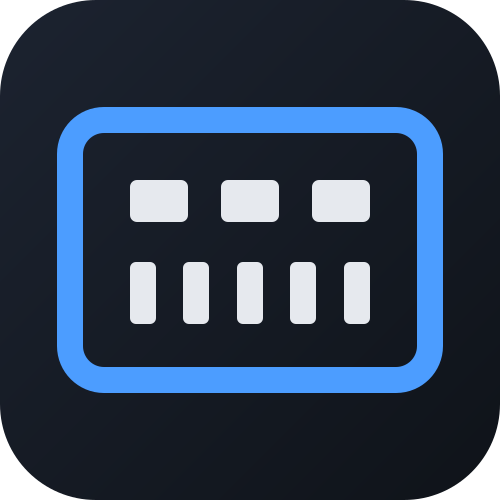
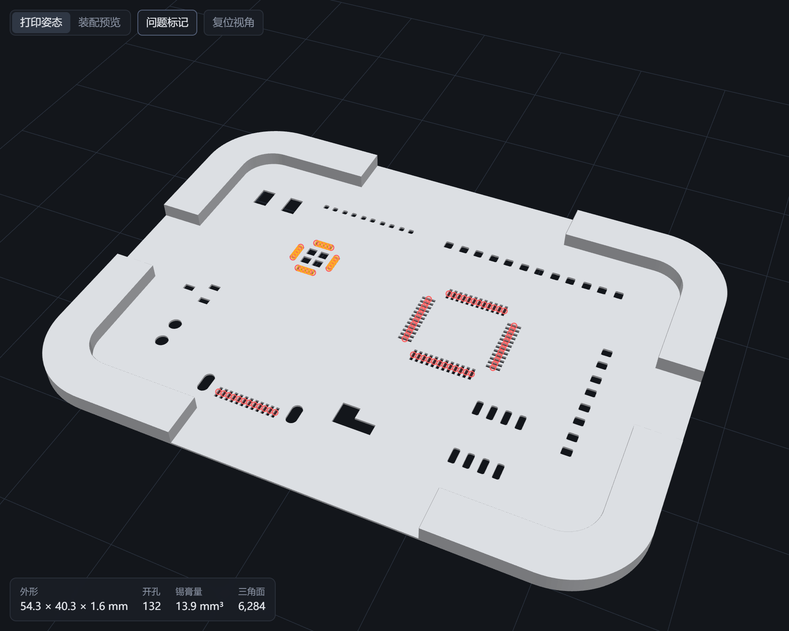
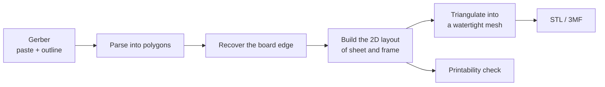

<p align="center">
  
</p>

<h1 align="center">EasyEDA 3D Stencil</h1>

<p align="center">
  <b>One click in EasyEDA Pro turns the open PCB into a solder paste stencil you can print on an ordinary FDM printer.</b>
</p>

<p align="center">
  <a href="https://github.com/ShanQuea/easyeda-3d-stencil/actions/workflows/ci.yml"></a>
  
  
  
</p>

<p align="center">
  <a href="https://shanquea.github.io/easyeda-3d-stencil/?lang=en"><b>Live demo</b></a> ·
  <a href="https://github.com/ShanQuea/easyeda-3d-stencil/releases">Download</a> ·
  <a href="#faq">FAQ</a> ·
  <a href="README.md">中文</a>
</p>


## Why

Prototype boards arrive, there are too many SMD parts to dab paste on by hand, and a steel stencil costs time and money for a board you may respin next week.

But there is a 3D printer sitting on the desk. A 0.2mm PETG sheet with the apertures cut out, plus a frame the board drops into, is a stencil that needs no alignment.

This extension handles the tedious parts: it reads the board, computes the apertures, builds the frame, tells you what will not print, and hands you an STL. From menu click to slicing takes about half a minute.

## Getting started

1. Download the `.eext` from [Releases](https://github.com/ShanQuea/easyeda-3d-stencil/releases) and import it in EasyEDA Pro under **Settings → Extensions → Extension Manager → Import**
2. Open a PCB and choose **3D Stencil → Generate 3D Printed Stencil**
3. Pick your nozzle, check the board thickness, export STL or 3MF

Not using EasyEDA? The [web version](https://shanquea.github.io/easyeda-3d-stencil/?lang=en) takes a Gerber zip from KiCad, Altium or anything else by drag and drop.

## What to expect

An FDM line is as wide as the nozzle, so this will not replace a laser-cut stencil. It does cover the common packages:

| Package | 0.2 nozzle | 0.25 nozzle | 0.4 nozzle | 0.6 nozzle |
| --- | :---: | :---: | :---: | :---: |
| 0805 / 0603, SOT-23, SOIC (1.27mm) | ✅ | ✅ | ✅ | ✅ |
| 0402, TSSOP (0.65mm) | ✅ | ✅ | ✅ | ❌ |
| LQFP / QFN (0.5mm) | ✅ | ⚠️ | ❌ | ❌ |
| QFN (0.4mm) | ⚠️ | ❌ | ❌ | ❌ |
| BGA, 0201 | ❌ | ❌ | ❌ | ❌ |

The table is derived from line widths and your printer may do better or worse. You do not need to memorise it: anything that will not print is circled in the preview.

## Features

### An alignment frame sized from the board thickness

The frame is slightly shorter than the board, so the board is held on all sides while the sheet sits flat on its surface.

| Full (with finger notches) | Corners | None |
| :---: | :---: | :---: |
|  |  |  |

Inside corners get a small relief circle, because FDM tends to blob there and would keep a sharp board corner from seating.

### Nozzle presets

Pick the nozzle that is on your printer and the thickness, aperture offset and fit clearance switch to matching values, together with the layer height and line width to enter in your slicer.

| Nozzle | Thickness | Aperture offset | Clearance | Layer height / line width |
| :---: | :---: | :---: | :---: | :---: |
| 0.2 | 0.12 | +0.03 | 0.10 | 0.12 / 0.22 |
| 0.25 | 0.14 | +0.02 | 0.12 | 0.14 / 0.27 |
| 0.4 | 0.20 | 0 | 0.15 | 0.20 / 0.42 |
| 0.6 | 0.24 | 0 | 0.20 | 0.24 / 0.62 |

### Webs are kept printable

If the web between two apertures is thinner than one extrusion line, the slicer either drops it (the two pads bridge) or squeezes a full line in and closes the apertures.

So both neighbours are trimmed a little. A 0.15mm web with a 0.2mm nozzle gives up 0.025mm on each side and becomes exactly one line wide. Apertures that would clog if trimmed are left alone and reported instead.

### Printability check

Apertures that will clog are circled in red, webs that are too thin in amber. Same board, different nozzle:

| 0.4 nozzle: the 0.5mm pitch QFP is all red | 0.2 nozzle: clean |
| :---: | :---: |
|  |  |

### Assembled preview

See the stencil sitting on the board to confirm every pad is exposed and nothing is flipped.

<p align="center"></p>

### Also

- The top-side stencil is mirrored automatically (see the [FAQ](#faq))
- STL and 3MF export with strictly watertight meshes
- Chinese and English UI, following the EasyEDA language setting
- Parameters are remembered between sessions

## What the stencil looks like

Printed like this, no supports needed:

```
          ┌───┐                         ┌───┐   frame: board thickness - 0.2
   ───────┴───┴──   ──   ──   ──   ─────┴───┴─  sheet: 0.12 to 0.24, i.e. the first layer
   ═══════════════════ bed ═══════════════════
```

Flipped onto the board for use:

```
   ─────────────   ──   ──   ──   ────────────  smooth side up, squeegee here
          └───┘  ┌───────────────┐  └───┘
                 │      PCB      │              frame grips the board edge
   ══════════════╧═══════════════╧════════════  table
```

## Printing tips

- **Material**: PETG is tougher than PLA and survives the squeegee better
- **Plate**: use a smooth one, since the bed side becomes the squeegee side
- **First layer**: the sheet is the first layer. Slow it down to about 20mm/s
- **Elephant-foot compensation**: keep it small or the apertures grow
- **Squeegee**: an old card works fine

## FAQ

**Why is the top stencil mirrored?**
The bed side is the smoothest and is where you want to squeegee, and the frame has to point up to print without supports. So the print gets flipped for use, and flipping mirrors it. The bottom side needs no mirroring because bottom Gerber layers are already viewed through the board from the top.

**The board does not fit, or is loose.**
Adjust the fit clearance in 0.05mm steps. Printers differ, so the first one may need a retry.

**The apertures came out closed.**
Either the nozzle is too coarse (look for red marks in the check) or the first layer is squished too hard. Add a little positive aperture offset or use a finer nozzle.

**The board thickness is wrong.**
It is read from the PCB stackup and falls back to 1.6mm. You can type over it.

**Does it work with KiCad or Altium?**
The extension itself runs inside EasyEDA, but the [web version](https://shanquea.github.io/easyeda-3d-stencil/?lang=en) reads standard RS-274X Gerbers. It needs a paste layer (`F_Paste` / `.GTP`) and an outline layer (`Edge_Cuts` / `.GKO`).

**Are my Gerbers uploaded anywhere?**
No. Everything runs locally in the browser. There is no backend.

## How it works



The engine lives in `src/core`. It is plain TypeScript with no DOM or EDA dependency and can be used on its own:

| File | What it does |
| --- | --- |
| `gerber.ts` | Hand-written RS-274X parser: standard apertures, aperture macros with expressions, arcs, regions, polarity, step-and-repeat |
| `outline.ts` | The outline layer is a stroked line. Chaining the segments into closed loops recovers the centreline, which is the real board edge |
| `stencil.ts` | Offsets the board for clearance and frame, clips the paste shapes to the board, trims apertures to keep webs. All 2D polygon booleans |
| `mesh.ts` | One constrained Delaunay triangulation over every region boundary, then heights and side walls |
| `analyze.ts` | A morphological opening of the material; whatever disappears is a web too thin to print |
| `export.ts` | Binary STL and 3MF |

A note on the mesh: the sheet and the frame are regions of different height. Extruding them separately and gluing them together tends to leave T-junctions that slicers complain about. Here the whole plane is triangulated once with shared vertices and each triangle is then assigned a height, so every edge ends up shared by exactly two triangles. The tests verify this for every parameter combination.

The UI in `src/app` uses a small hand-written WebGL2 viewer rather than three.js, and the whole page bundles to under 300KB. It is built into one self-contained HTML file that serves as both the extension window and the GitHub Pages demo.

## Development

```bash
npm install
npm test            # unit tests
npm run build       # package the extension into build/dist/*.eext
npm run debug       # live reload into a running EasyEDA
npm run build:app   # UI only, then open iframe/index.html in a browser
npm run screenshots # regenerate the README screenshots
```

## Roadmap

- [ ] Alignment by mounting holes and pins, for boards where a frame does not work
- [ ] Pick a single board out of a panel
- [ ] Feed real print measurements back into the nozzle presets

Ideas and photos of your prints are welcome in the issues.

## Credits

- [easyeda-api-sdk](https://github.com/easyeda/easyeda-api-sdk) – the official extension scaffold
- [clipper-lib](https://sourceforge.net/projects/jsclipper/) – polygon booleans
- [cdt2d](https://github.com/mikolalysenko/cdt2d) – constrained Delaunay triangulation
- [JSZip](https://stuk.github.io/jszip/) – reading Gerber archives and writing 3MF

## License

[Apache-2.0](LICENSE)
