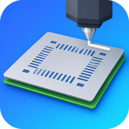
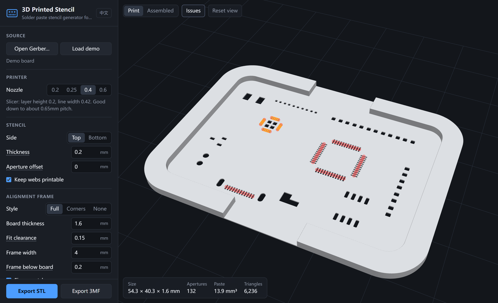
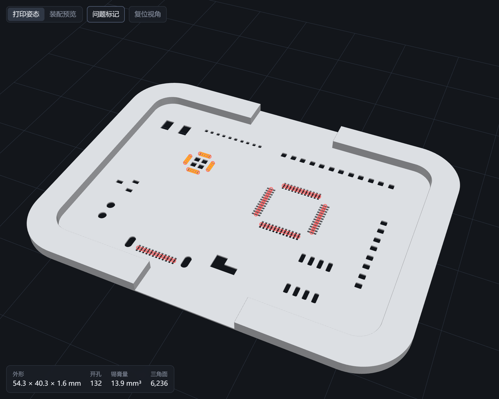
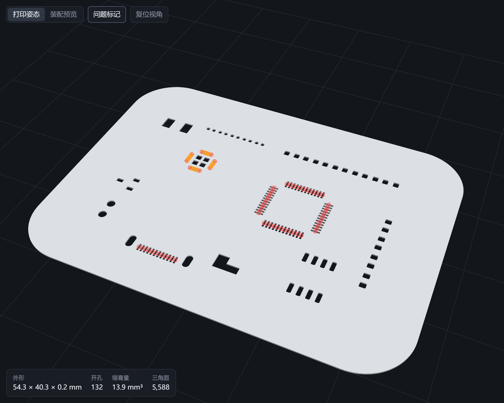
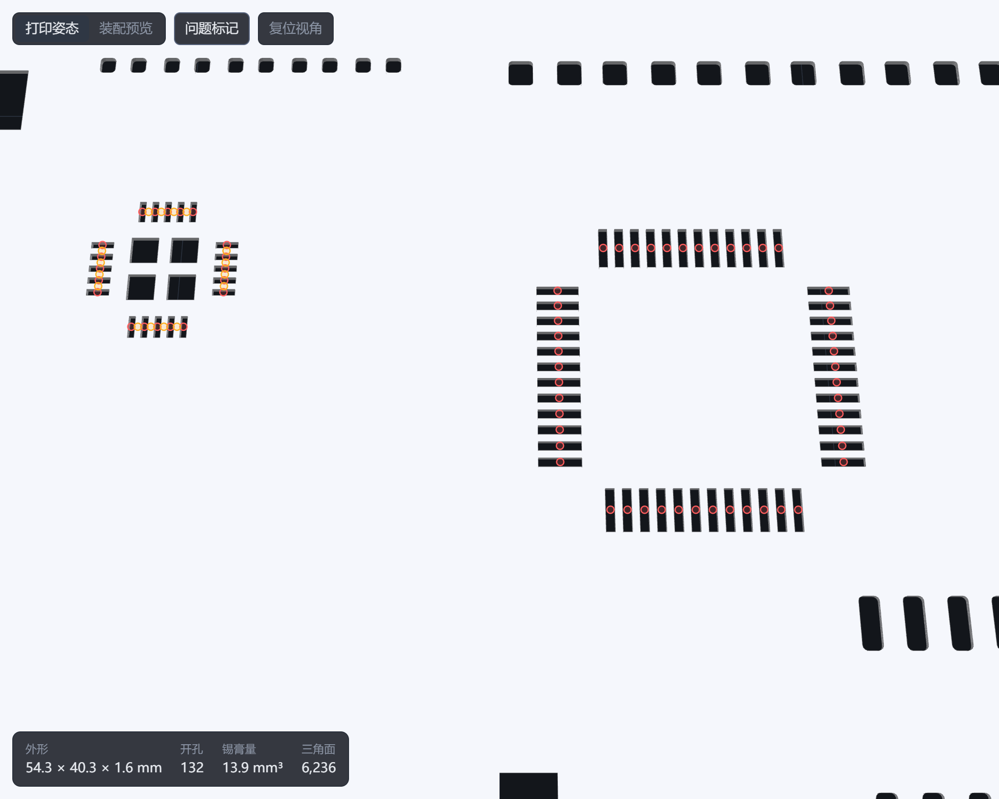
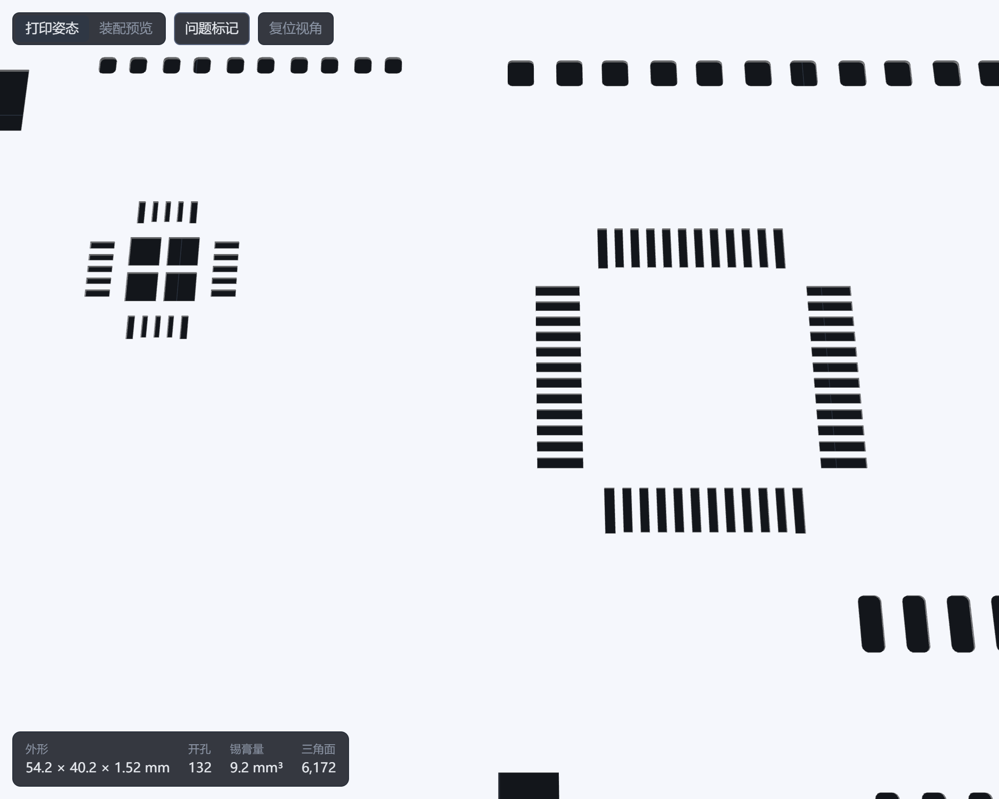

<p align="center">
  
</p>

<h1 align="center">EasyEDA 3D Stencil</h1>

<p align="center">An EasyEDA Pro extension that turns the open PCB into a solder paste stencil you can print on an FDM printer.</p>

<p align="center">
  <a href="https://github.com/ShanQuea/easyeda-3d-stencil/actions/workflows/ci.yml"></a>
  
</p>

<p align="center">
  <a href="https://shanquea.github.io/easyeda-3d-stencil/?lang=en">Try it online</a> ·
  <a href="https://github.com/ShanQuea/easyeda-3d-stencil/releases">Download</a> ·
  <a href="README.md">中文</a>
</p>



Dabbing paste onto a prototype board with a syringe gets old fast, and ordering a steel stencil for every revision costs time and money. So this prints a thin sheet with the apertures cut out, plus a frame that holds the board in place so there is nothing to align.

## Usage

1. Download the `.eext` from [Releases](https://github.com/ShanQuea/easyeda-3d-stencil/releases)
2. In EasyEDA Pro: Settings → Extensions → Extension Manager → Import
3. Select the extension in the manager, open the Configure tab and tick "Show in top menu". Otherwise the menu lives under Advanced
4. Open a PCB and choose 3D Stencil → Generate 3D Printed Stencil

Developed and tested on EasyEDA Pro V4.1.100. The manifest allows V3.2 and later, but older versions have not been tested. Issues welcome.

Not on EasyEDA? The [web version](https://shanquea.github.io/easyeda-3d-stencil/?lang=en) takes a Gerber zip from KiCad, Altium etc. It needs a paste layer and an outline layer.

## Features

- A frame sized from the board thickness: full, corner clips, or none
- Nozzle presets (0.2 / 0.25 / 0.4 / 0.6, or any custom size) that set sheet thickness, aperture offset and fit clearance, and tell you what layer height and line width to use
- When a web between pads is thinner than one extrusion line, both apertures are trimmed slightly so the web survives. Apertures too small to trim are left alone and reported
- Printability check: apertures that will clog are marked red, webs too thin to print amber; click an issue to zoom to it
- Laser cut mode: switch to "Laser cut" at the top to get a DXF / SVG for PET film or steel. Apertures are 1:1 from Gerber with no nozzle tweaks; outline is blue, apertures red, so laser software can put them on separate layers. The cut sheet view zooms in to check every aperture
- Jig: a printable base for a frameless stencil from a fab such as JLCPCB. The board sits flush in a pocket shaped like the outline, and a shallow pocket on top takes the stencil sheet so the apertures land on the pads. Three ways to place the sheet: centred (it tells you the margins to check with a ruler), measured (enter the left and bottom margins from your actual sheet), or by eye (2mm of slack, then tape it). "Other side populated" opens the pocket floor for the second side
- Merge fine-pitch rows: when the nozzle cannot print each aperture, a whole row of pins becomes one narrow slot with less paste (60% by default). Reflow pulls the paste back onto the pads; drag-solder any bridges. Meant for leaded packages like SOIC and QFP, use with care on QFN
- Assembled preview of the stencil sitting on the board
- Top side mirrored automatically, STL / 3MF export

| Full | Corners | None |
| :---: | :---: | :---: |
|  |  |  |

Same board: the 0.5mm pitch QFP is all red with a 0.4 nozzle and clean with a 0.2:

| 0.4 | 0.2 |
| :---: | :---: |
|  |  |

## How fine can it go

An FDM line is roughly as wide as the nozzle, so this won't replace a laser-cut stencil. Rough guide, derived from line widths:

- 0.4 nozzle: 0603, 0805, SOT-23, SOIC and TSSOP are fine; 0.5mm pitch QFP/QFN needs "Merge fine-pitch rows"
- 0.2 nozzle: 0402 and 0.5mm pitch QFP/QFN work, 0.4mm pitch is borderline
- BGA and 0201: no

Preset defaults:

| Nozzle | Thickness | Aperture offset | Clearance |
| :---: | :---: | :---: | :---: |
| 0.2 | 0.12 | +0.03 | 0.10 |
| 0.25 | 0.14 | +0.02 | 0.12 |
| 0.4 | 0.20 | 0 | 0.15 |
| 0.6 | 0.24 | 0 | 0.20 |

## Printing and use

Print frame side up, no supports. The bed side is the flattest, so flip the print onto the board and squeegee on that side. Because of the flip, the top-side stencil is generated mirrored; the bottom side is not.

PETG is recommended over PLA since it is tougher under the squeegee. Use a smooth plate, slow the first layer to around 20mm/s and keep elephant-foot compensation small or the apertures grow. An old card works as a squeegee.

If the board doesn't fit or is loose, adjust the fit clearance in 0.05mm steps. If apertures come out closed, the nozzle is too coarse or the first layer is squished too hard; try a bit of positive aperture offset. Board thickness is read from the stackup and falls back to 1.6mm; you can type over it.

Keep the PCB editor tab active when opening the extension. From the 3D view tab no Gerber can be read; switch back and hit Reload.

Everything runs locally in the browser. Nothing is uploaded.

## Development

```bash
npm install
npm test
npm run build       # output in build/dist/*.eext
npm run debug       # live reload into a running EasyEDA
npm run build:app   # UI only
npm run screenshots # regenerate screenshots
```

## TODO

- [ ] Pin alignment through mounting holes for odd-shaped boards
- [ ] Pick a single board out of a panel
- [ ] Tune the nozzle presets from real prints

Issues and photos of your prints are welcome.

## Credits

[easyeda-api-sdk](https://github.com/easyeda/easyeda-api-sdk) · [clipper-lib](https://sourceforge.net/projects/jsclipper/) · [cdt2d](https://github.com/mikolalysenko/cdt2d) · [JSZip](https://stuk.github.io/jszip/)

## License

[Apache-2.0](LICENSE)
