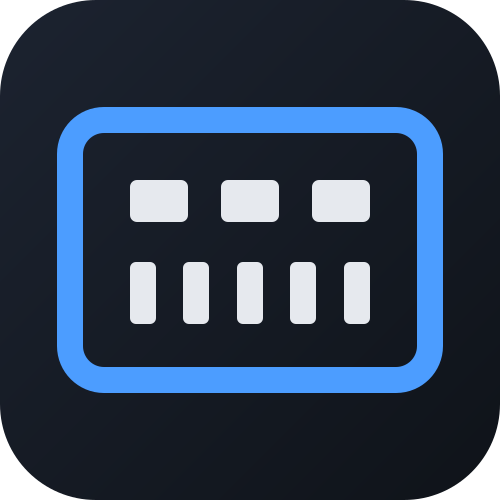
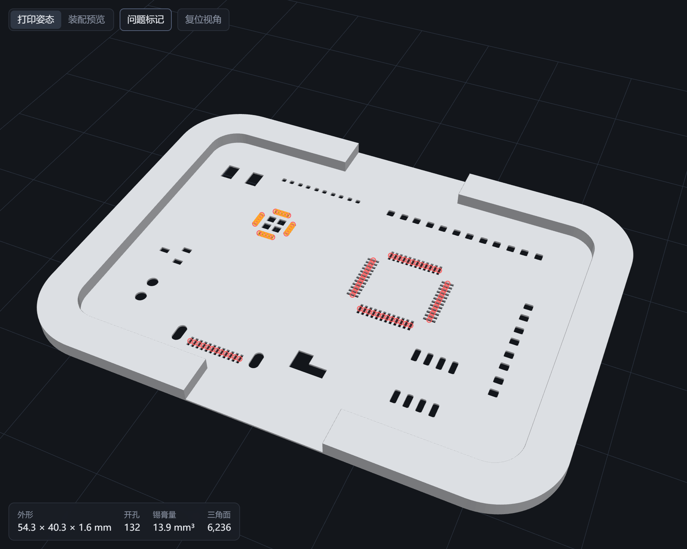
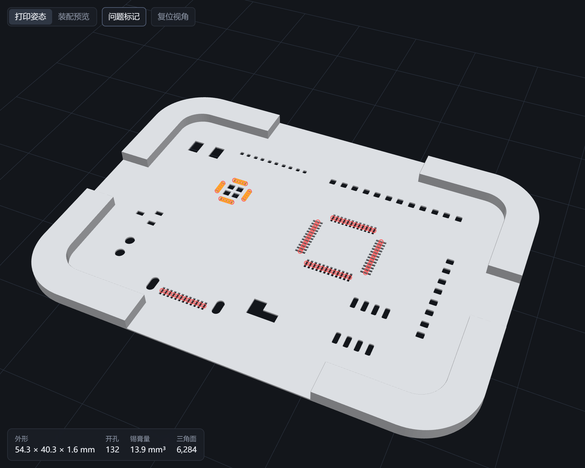
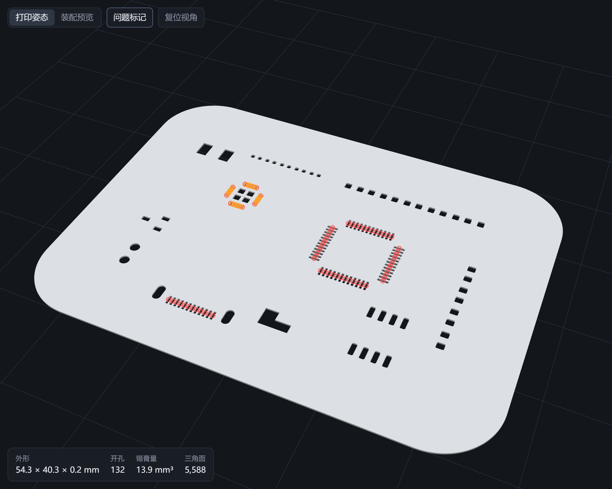
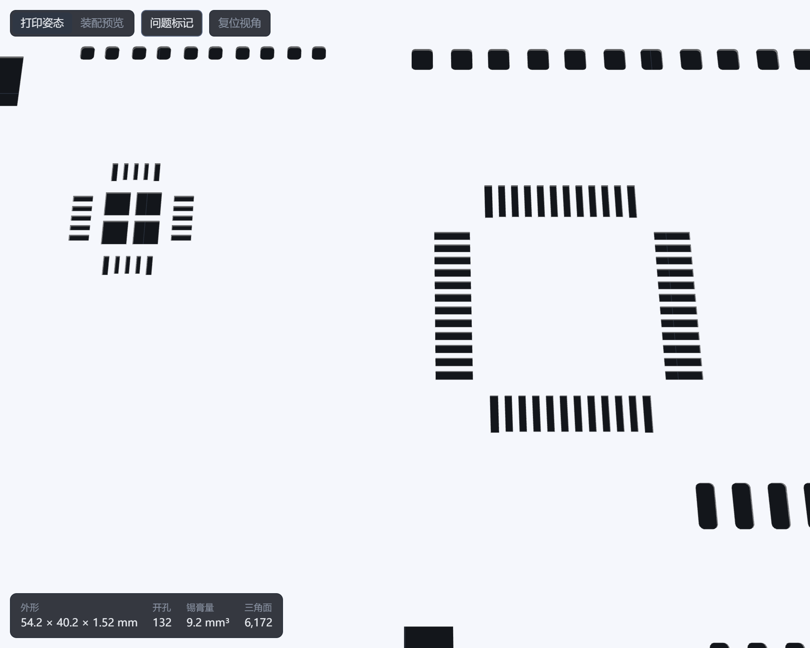
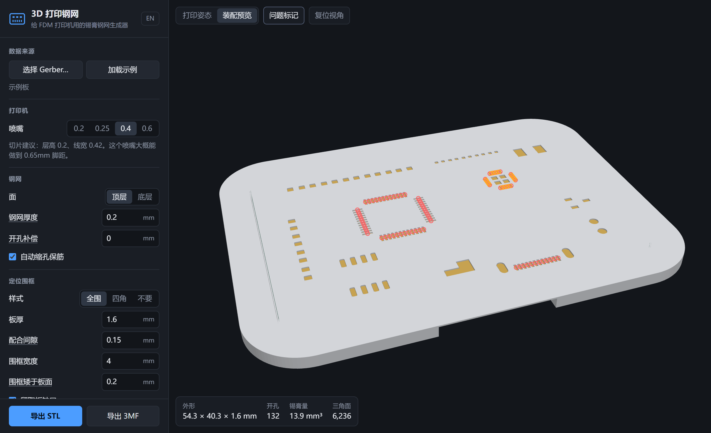
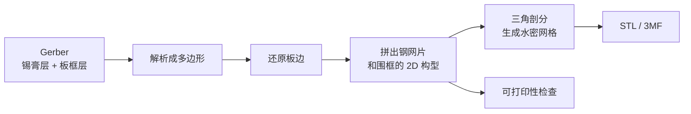

<p align="center">
  
</p>

<h1 align="center">EasyEDA 3D Stencil</h1>

<p align="center">
  <b>在嘉立创EDA 里点一下，把当前 PCB 变成能用 FDM 打印机直接打出来的锡膏钢网。</b>
</p>

<p align="center">
  <a href="https://github.com/ShanQuea/easyeda-3d-stencil/actions/workflows/ci.yml"></a>
  
  
  
</p>

<p align="center">
  <a href="https://shanquea.github.io/easyeda-3d-stencil/"><b>在线试玩</b></a> ·
  <a href="https://github.com/ShanQuea/easyeda-3d-stencil/releases">下载扩展</a> ·
  <a href="#常见问题">常见问题</a> ·
  <a href="README.en.md">English</a>
</p>


## 为什么做这个

打样的板子到手，贴片件一多，拿针筒一个个点锡膏真的很烦。开钢网吧，要等、要加钱，板子改一版就得重开一张。

可是桌上明明就有台 3D 打印机。一张 0.2mm 厚的 PETG 薄片，开好孔，四周再长一圈围框把板子卡住——这不就是一张不用对位的钢网吗？

这个扩展把中间那些麻烦事都包了：读板子、算开孔、生成围框、检查哪里打不出来，最后给你一个 STL。从点菜单到开始切片，大概半分钟。

## 三步用起来

1. 到 [Releases](https://github.com/ShanQuea/easyeda-3d-stencil/releases) 下载 `.eext`，在嘉立创EDA专业版里 **设置 → 扩展 → 扩展管理器 → 导入扩展**
2. 打开 PCB，点顶部菜单 **3D 钢网 → 生成 3D 打印钢网**
3. 选喷嘴，核对板厚，导出 STL 或 3MF

不用嘉立创EDA 也行，[网页版](https://shanquea.github.io/easyeda-3d-stencil/)直接把 KiCad、Altium 导出的 Gerber 压缩包拖进去。

## 能做到什么程度

先说实话：FDM 的线宽就是喷嘴直径，这东西替代不了激光钢网，但对付常见封装够用。

| 封装 | 0.2 喷嘴 | 0.25 喷嘴 | 0.4 喷嘴 | 0.6 喷嘴 |
| --- | :---: | :---: | :---: | :---: |
| 0805 / 0603、SOT-23、SOP（1.27mm） | ✅ | ✅ | ✅ | ✅ |
| 0402、TSSOP（0.65mm） | ✅ | ✅ | ✅ | ❌ |
| LQFP / QFN（0.5mm） | ✅ | ⚠️ | ❌ | ❌ |
| QFN（0.4mm） | ⚠️ | ❌ | ❌ | ❌ |
| BGA、0201 | ❌ | ❌ | ❌ | ❌ |

这张表是按线宽推出来的，具体还看你机器的状态。不过不用背它——打不出来的地方扩展会直接在预览里圈出来。

## 功能

### 按板厚生成的卡板围框

围框比板子矮一点点，板子放进去四边卡住，钢网片正好压在板面上，不需要对位。三种样式随便切：

| 全围（带取板缺口） | 四角卡扣 | 不要围框 |
| :---: | :---: | :---: |
|  |  |  |

围框内角会自动挖一个避让圆。FDM 打内角容易堆料，不挖的话板子的尖角会被顶住放不平。

### 选喷嘴，参数跟着变

选好打印机上装的喷嘴，钢网厚度、开孔补偿、配合间隙会一起换成对应的推荐值，同时告诉你切片软件里层高和线宽填多少。改过的参数会高亮，一键可以恢复。

| 喷嘴 | 钢网厚度 | 开孔补偿 | 配合间隙 | 切片层高 / 线宽 |
| :---: | :---: | :---: | :---: | :---: |
| 0.2 | 0.12 | +0.03 | 0.10 | 0.12 / 0.22 |
| 0.25 | 0.14 | +0.02 | 0.12 | 0.14 / 0.27 |
| 0.4 | 0.20 | 0 | 0.15 | 0.20 / 0.42 |
| 0.6 | 0.24 | 0 | 0.20 | 0.24 / 0.62 |

### 自动缩孔保筋

两个孔之间那条筋如果比一条线还窄，切片软件要么直接丢掉它（两个焊盘的锡膏连成一片），要么硬挤一条线把孔堵上。

所以筋不够宽的时候，扩展会把两边的孔各缩一点。比如筋只有 0.15、喷嘴 0.2，就两边各让 0.025，筋刚好变成一条线宽。如果孔本来就窄到再缩会堵死，那就不动它，留给下面的检查去报。

### 可打印性检查

孔太窄会糊死（红圈），筋太细打不出来（黄圈）。同一块板子，换个喷嘴差别很明显：

| 0.4 喷嘴：0.5mm 脚距的 QFP 全红 | 0.2 喷嘴：没问题 |
| :---: | :---: |
|  |  |

### 装配预览

切到装配预览可以看钢网扣在板子上的样子，确认每个焊盘都露出来了、方向没反。

<p align="center"></p>

### 其他

- 顶层钢网自动镜像（原因见[常见问题](#常见问题)）
- 导出 STL 和 3MF，网格严格水密，切片软件不会报"模型有破面"
- 中英双语，跟随嘉立创EDA 的语言设置
- 参数会记住，下次打开还在

## 钢网长什么样

打印的时候是这个姿态，不需要支撑：

```
          ┌───┐                         ┌───┐   围框：高度 = 板厚 - 0.2
   ───────┴───┴──   ──   ──   ──   ─────┴───┴─  钢网片：0.12 ~ 0.24，也就是第一层
   ══════════════════ 热床 ═══════════════════
```

用的时候翻过来扣在板子上：

```
   ─────────────   ──   ──   ──   ────────────  光面朝上，在这面刮锡膏
          └───┘  ┌───────────────┐  └───┘
                 │      PCB      │              围框卡住板边，下沿悬空 0.2
   ══════════════╧═══════════════╧════════════  桌面
```

## 打印建议

- **材料**：PETG 优先，比 PLA 韧，刮的时候不容易崩角
- **热床**：用光面板。贴床的那面就是刮锡膏的面，越光越好刮
- **首层**：钢网片就是第一层，速度降到 20mm/s 左右，宁慢勿糙
- **象脚补偿**：别开太大，不然孔会被撑大
- **刮刀**：旧银行卡、塑料铲刀都行，一遍刮过去别来回蹭

## 常见问题

**顶层钢网为什么是镜像的？**
钢网贴热床的那面最光滑，适合刮锡膏；带围框的那面朝上打才不需要支撑。所以用的时候得翻个面，而翻面等于左右镜像一次，那就得先反着打。底层不用，因为 Gerber 里的底层本来就是从顶面透视着看的，翻过来正好。

**板子卡不进围框 / 太松？**
调"配合间隙"。卡不进就加 0.05，太松就减。每台机器的尺寸偏差不一样，第一次可能要试一下。

**打出来孔是堵的？**
要么喷嘴太粗（看检查里有没有红的），要么首层压得太扁。可以加一点正的"开孔补偿"，或者换细喷嘴。

**板厚没读对？**
板厚是从 PCB 叠层设置里读的，读不到会用 1.6。界面上能直接改。

**支持 KiCad / Altium 吗？**
扩展本身只在嘉立创EDA 里跑，但[网页版](https://shanquea.github.io/easyeda-3d-stencil/)吃标准 Gerber（RS-274X），把导出的压缩包拖进去就行。需要锡膏层（`F_Paste` / `.GTP`）和板框层（`Edge_Cuts` / `.GKO`）。

**我的 Gerber 会被上传吗？**
不会。所有计算都在浏览器本地完成，没有后端。

## 它是怎么算出来的



引擎在 `src/core`，纯 TypeScript，不碰 DOM 也不碰 EDA 接口，可以单独拿去用：

| 文件 | 干什么 |
| --- | --- |
| `gerber.ts` | 手写的 RS-274X 解析器：标准光圈、光圈宏（带表达式）、圆弧、区域填充、正负极性、阵列 |
| `outline.ts` | 板框在 Gerber 里是一圈有宽度的线，把线段首尾串成闭环，取中心线才是真正的板边 |
| `stencil.ts` | 板边外扩出间隙和围框，锡膏图形裁到板内当开孔，再做缩孔保筋。全是 2D 多边形布尔运算 |
| `mesh.ts` | 所有区域的边界放在一起做一次约束 Delaunay 三角剖分，按区域给高度、补侧壁 |
| `analyze.ts` | 对材料做形态学开运算，被抹掉的部分就是打不出来的细筋 |
| `export.ts` | 二进制 STL 和 3MF |

网格这块多说一句：钢网片和围框是两个高度不同的区域，分开拉伸再拼起来的话，交界处很容易出 T 形缝，切片软件会报错。这里是先把整个平面剖成一张共用顶点的三角网，再给每个三角形定高度，所以每条边必然恰好被两个三角形共享——测试里对每种参数组合都验了这一点。

界面在 `src/app`，3D 预览是手写的 WebGL2（没用 three.js，整个页面打包完不到 300KB）。构建时打成一个自包含的 HTML，扩展里的窗口和 GitHub Pages 上的网页版用的是同一份。

## 开发

```bash
npm install
npm test            # 单元测试
npm run build       # 打包扩展，产物在 build/dist/*.eext
npm run debug       # 连本机的嘉立创EDA 热更新调试
npm run build:app   # 只构建界面，浏览器直接打开 iframe/index.html
npm run screenshots # 重新生成 README 里的截图
```

```
src/
├── index.ts        扩展入口，只负责开窗口
├── core/           引擎（解析、几何、网格、导出）
└── app/            界面和 3D 预览
test/               引擎的单元测试
scripts/            界面打包、截图
build/ config/      嘉立创官方 SDK 的脚手架
```

## 接下来想做的

- [ ] 用定位孔 + 销钉对位，给没法用围框的异形板
- [ ] 拼板时只出其中一块
- [ ] 把打印出来的实测数据补到喷嘴预设里

有想法或者打出来的效果，欢迎开 issue 聊。

## 致谢

- [easyeda-api-sdk](https://github.com/easyeda/easyeda-api-sdk)：嘉立创官方的扩展开发脚手架
- [clipper-lib](https://sourceforge.net/projects/jsclipper/)：多边形布尔运算
- [cdt2d](https://github.com/mikolalysenko/cdt2d)：约束 Delaunay 三角剖分
- [JSZip](https://stuk.github.io/jszip/)：读 Gerber 压缩包、写 3MF

## License

[Apache-2.0](LICENSE)
