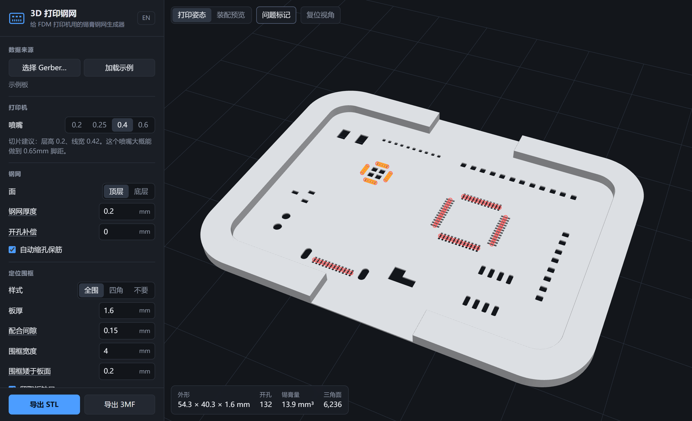
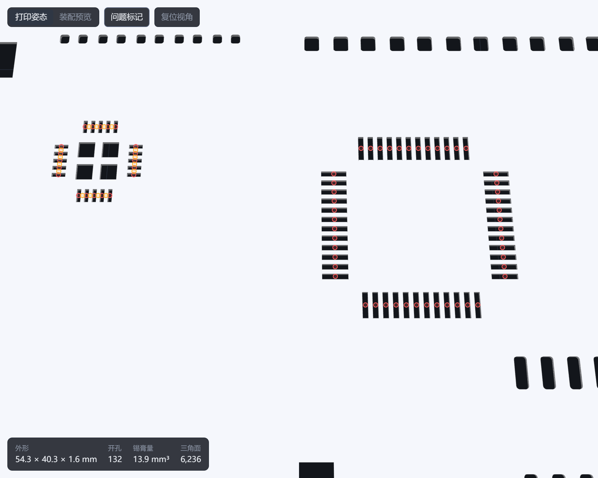

<p align="center">
  
</p>

<h1 align="center">EasyEDA 3D Stencil</h1>

<p align="center">嘉立创EDA 专业版扩展：把当前 PCB 导出成 FDM 打印机能打的锡膏钢网。</p>

<p align="center">
  <a href="https://github.com/ShanQuea/easyeda-3d-stencil/actions/workflows/ci.yml"></a>
  
</p>

<p align="center">
  <a href="https://shanquea.github.io/easyeda-3d-stencil/">在线试用</a> ·
  <a href="https://github.com/ShanQuea/easyeda-3d-stencil/releases">下载</a> ·
  <a href="https://github.com/ShanQuea/easyeda-3d-stencil/blob/main/README.en.md">English</a>
</p>



打样板子回来，贴片件多的时候拿针筒点锡膏很折腾，单独开钢网又要等又要钱。桌上反正有台 3D 打印机，就写了这个：打一张薄片当钢网，四周带一圈框把板子卡住，不用对位。

## 使用方法

1. 在 [Releases](https://github.com/ShanQuea/easyeda-3d-stencil/releases) 下载 `.eext`
2. 嘉立创EDA 里 设置 → 扩展 → 扩展管理器 → 导入扩展
3. 在扩展管理器里点开这个扩展，切到「配置」，勾上「显示在顶部菜单」。不勾的话菜单在「高级」里
4. 打开 PCB，顶部菜单 3D 钢网 → 生成 3D 打印钢网

开发和实测用的是嘉立创EDA 专业版 V4.1.100。扩展声明支持 V3.2 及以上，但老版本没有实际测过，遇到问题欢迎提 issue。

不用嘉立创EDA 的话，[网页版](https://shanquea.github.io/easyeda-3d-stencil/) 可以直接拖 Gerber 压缩包进去（KiCad、Altium 导出的都行，要有锡膏层和板框层）。

## 功能

- 按板厚生成卡板的围框，可选全围、四角卡扣或不要
- 选喷嘴（0.2 / 0.25 / 0.4 / 0.6，也可以填别的直径）自动带出钢网厚度、开孔补偿和配合间隙，并给出切片的层高线宽
- 焊盘间的筋比一条线还窄时，两边的孔各缩一点把筋保住；孔本身太窄缩不动的就不缩，交给检查去报
- 可打印性检查：会堵的孔标红，太细的筋标黄，点问题列表直接定位过去
- 细间距合并成条：喷嘴打不出单孔的整排脚，可以并成一条窄缝，锡量按比例缩（默认 60%），回流时锡会被拉回焊盘，有连锡用烙铁拖一下。适合 SOP、QFP 这类有引脚的封装，QFN 慎用
- 装配预览，看钢网扣到板子上的样子
- 顶层自动镜像，导出 STL / 3MF

| 全围 | 四角 | 无围框 |
| :---: | :---: | :---: |
|  |  |  |

同一块板，0.4 喷嘴下 0.5mm 脚距的 QFP 全红，换 0.2 就没问题：

| 0.4 | 0.2 |
| :---: | :---: |
|  |  |

## 能打多细

FDM 线宽基本就是喷嘴直径，所以别指望替代激光钢网。大概是这样（按线宽推的，具体看机器）：

- 0.4 喷嘴：0603、0805、SOT-23、SOP、TSSOP 没问题，0.5mm 脚距的 QFP/QFN 单孔打不出，可以开「细间距合并成条」
- 0.2 喷嘴：0402 和 0.5mm 脚距的 QFP/QFN 可以，0.4mm 脚距比较勉强
- BGA、0201 就别想了

喷嘴预设的默认值：

| 喷嘴 | 钢网厚度 | 开孔补偿 | 配合间隙 |
| :---: | :---: | :---: | :---: |
| 0.2 | 0.12 | +0.03 | 0.10 |
| 0.25 | 0.14 | +0.02 | 0.12 |
| 0.4 | 0.20 | 0 | 0.15 |
| 0.6 | 0.24 | 0 | 0.20 |

## 打印和使用

框朝上打，不用支撑。贴热床那面最平，用的时候翻过来扣在板子上，在这面刮锡膏。也因为要翻面，顶层钢网是镜像生成的，底层不用。

材料建议 PETG，比 PLA 韧，刮的时候不容易崩。热床用光面板，首层放慢到 20mm/s 左右，象脚补偿别开太大，不然孔会变大。刮刀用旧卡就行。

板子卡不进框或者太松，就调配合间隙，每次 0.05。孔打出来是堵的，一般是喷嘴太粗或者首层压太扁，加一点开孔补偿试试。板厚是从叠层设置里读的，读不到默认 1.6，可以手动改。

打开扩展时 EDA 当前页要停在 PCB 编辑页上，停在 3D 预览页会读不到 Gerber，切回去点重新读取就行。

所有计算都在本地浏览器里跑，Gerber 不会上传。

## 开发

```bash
npm install
npm test
npm run build       # 产物在 build/dist/*.eext
npm run debug       # 连本机嘉立创EDA 调试
npm run build:app   # 只构建界面
npm run screenshots # 重新生成截图
```

## TODO

- [ ] 异形板用定位孔 + 销钉对位
- [ ] 拼板只出其中一块
- [ ] 用实际打印的结果校准喷嘴预设

有问题或者打出来的效果欢迎发 issue。

## 致谢

[easyeda-api-sdk](https://github.com/easyeda/easyeda-api-sdk) · [clipper-lib](https://sourceforge.net/projects/jsclipper/) · [cdt2d](https://github.com/mikolalysenko/cdt2d) · [JSZip](https://stuk.github.io/jszip/)

## License

[Apache-2.0](https://github.com/ShanQuea/easyeda-3d-stencil/blob/main/LICENSE)
